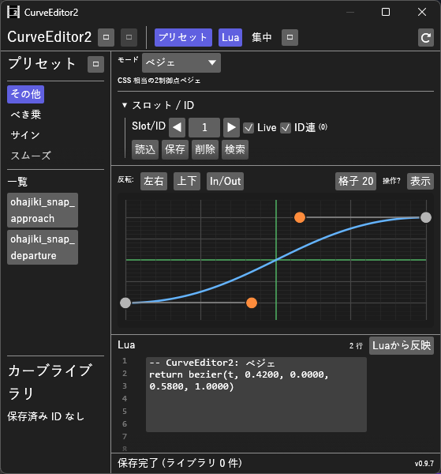

# CurveEditor_H マニュアル

**CurveEditor_H** は、AviUtl2でイージングを編集する汎用プラグインです。
トラックバーへの適用は、専用の `@カーブエディタ_H.tra2` を使用します。

以前作ったプラグインScriptCurveの後継です。
初代AviUtlの「Curve Editor for AviUtl」とは関係のない独立した作品で、そのコードは使っていません。
2026-10-10 に、名称の紛らわしさを避けるためCurveEditor2からCurveEditor_Hへ改名しました。

- **バージョン:** 0.11.0 / `@カーブエディタ_H.tra2` v1.20
- **作者:** by HexBrowns
- **必要環境:** AviUtl2 **2.1.10** 以上

---

## 開き方

- **表示** メニュー → **CurveEditor_H**

起動時はウィンドウを非表示のまま登録します。
表示リストに出ない場合はAviUtl2を再起動してください。

AviUtl2を起動した後に `@カーブエディタ_H.tra2` を置いた・更新したときは、移動方法が本体にまだ登録されていないので、ステータスに再起動の案内が出ます。
**AviUtl2を再起動してから**「このトラックに適用」してください。

### 画面の構成

上から順に固定パネルで並びます。**グラフが中央パネル**なので、ウィンドウを広げた分・
他のパネルを畳んだ分は、すべてグラフの高さになります。

| 位置 | 内容 |
|------|------|
| ツールバー | パネルの表示切替 |
| 操作パネル | モード、スロット / ID、トラック適用、プリセット、数値入力 |
| **グラフ** | **残りの高さすべて。**上端に反転と表示リセットだけを置いています |
| Lua欄 | 生成・手入力コード |
| 検索 / ステータス | 使用箇所検索、状態表示 |

- **操作パネルとLua欄は境界をドラッグして高さを変えられます。** 縮めた分はグラフが受け取ります
- 操作パネルは折りたたみ節に分かれています。**数値入力は既定で畳んで**います。
  **マルチベジェ / 標準(複合)** だけは、アンカー列と区間種別を使うので既定で開きます。
  開閉状態はモードごとに覚えます

### ウィンドウ操作

- **プリセット** ボタン: 左のプリセットパネルの表示／非表示を切り替え
- **Lua** ボタン: 下のLua欄の表示／非表示。閉じるとその高さはグラフへ回ります
- **集中** ボタン: グラフ集中モード。操作パネルとLua欄をまとめて畳み、
  ウィンドウのほぼ全部をグラフにします。ハンドルを細かく触りたいときに使います
- **✕** ボタンまたは **Esc**: 開いているポップアップ・使用箇所検索パネル・プリセットパネルを一括で閉じる。
  Escで閉じるのは、どの欄にも入力していないときだけです
- プリセット一覧から項目を選ぶと、読み込み後にプリセットパネルが自動で閉じます
- 座標・ζ / ω のスライダーの右の数値・スロット / ID・グリッドの数値の欄は、Enterかほかをクリックしたときに確定します。
  入力中にEscを押すと、入力する前の値に戻ります。確定するまでグラフ・Liveに反映しません。
  プリセット名の欄も、入力中のEscで入力する前の名前に戻ります。Lua欄だけはEscで戻りません

### コンパクトレイアウト

ウィンドウ幅に応じてUIが自動調整されます。

| 幅 | 挙動 |
|----|------|
| **520px 未満** | モード選択をコンボボックス化、ボタン・ラベルを短縮、スライダーを縦並び、説明文を圧縮 |
| **380px 未満** | スクリプトエディタの行番号・プレビュー非表示、モード名を略記 |

狭いドッキング配置でも、編集・適用・Liveが使えます。
グラフの高さは幅ではなく**ウィンドウの残り高さ**で決まります。

## 概要

CurveEditor_Hは専用のトラックバー移動スクリプト **`@カーブエディタ_H.tra2`** と連携します。移動方法の表示名は **「カーブエディタ_H」** です。

| ファイル | 役割 | 配置先 |
|---------|------|--------|
| `CurveEditor_H.aux2` | イージング編集GUI | `Plugin\CurveEditor_H\` |
| `@カーブエディタ_H.tra2` | トラックバー補間本体 | `Script\CurveEditor_H\` |
| `Presets.lua` | プリセット | `Plugin\CurveEditor_H\` |
| `Live_active.lua` | Live同期 | `Plugin\CurveEditor_H\` |
| `{プロジェクト名}.CurveEditor_H.Live.lua` | プロジェクト別Live保存 | プロジェクトフォルダ |
| `{プロジェクト名}.CurveEditor_H.Library.json` | プロジェクト別カーブライブラリ | プロジェクトフォルダ |

> 旧プロジェクトの **スクリプトカーブ** 適用箇所は、使用箇所検索で引き続き検出できます。新規適用は **カーブエディタ_H** を使用してください。

---

## 導入

1. [Releases](https://github.com/HexBrowns/CurveEditor_H/releases) から `HexBrowns.CurveEditor_H-v0.11.0.au2pkg.zip` をダウンロードし、AviUtl2のプレビューへドラッグ&ドロップする。
   手で置く場合は、中の `Plugin` フォルダと `Script` フォルダをAviUtl2のデータフォルダへコピーします。
   次の 2 つが置かれます
   - `Plugin\CurveEditor_H\CurveEditor_H.aux2`
   - `Script\CurveEditor_H\@カーブエディタ_H.tra2`
2. AviUtl2を再起動する。
3. **表示** メニュー → **CurveEditor_H** でウィンドウを開く。

v0.9.7 まではzipを展開して置く形でした。上書きで入れ替えて構いません。
Live・プリセット・ライブラリはそのまま使えます。

Liveとプリセットのファイルは、データフォルダの `Plugin\CurveEditor_H\` に作られます。
`.tra2` はデータフォルダの場所を `obj.getinfo("script_path")` から求めてLiveを読みます。
そのため、データフォルダが既定と違う環境でもLiveが読める見込みです。ポータブル版では確かめていません。

---

## 使い方

### 1. トラックバーへの適用

1. タイムラインで適用先オブジェクトを選択。
   ウィンドウ表示中は、オブジェクトを選び直す・動かす・名前を変えるなどしたときに、トラック一覧を自動で取得します。
   手動の **「トラック取得」** もあります。
   ウィンドウを隠している間は取得せず、出したときに選んでいるオブジェクトのトラックを取得します。
2. CurveEditor_Hでカーブを編集。
3. コンボボックスからトラックを選択。
4. **適用先:** ラベルで、Live #Nか組み込みセクションかを確認。
5. **「このトラックに適用」** をクリック。

移動方法がまだ付いていない固定値のトラックへも適用できます。
開始値＝終了値の移動として書き込むので、あとはオブジェクト設定で終了値を変えるだけです。

オブジェクトの 2 番目以降に置いた効果へも適用できます。
書き込めなかった場合は、成功と報告せずエラーを表示します。

移動方法の形式:

- Live: `開始,終了,カーブエディタ_H@カーブエディタ_H,0|N`。加減速・時間制御を付けると `加減速|N|時間制御`
- Liveの別セクション: `区間ごとにスロットを進める@カーブエディタ_H` / `全体で1本@カーブエディタ_H`。設定は同じ形
- 組み込み: `開始,終了,セクション@カーブエディタ_H,0`。例: `バウンス@カーブエディタ_H`

すでにLiveのセクションが付いているトラックへ「このトラックに適用」すると、
**セクションはそのままでスロット番号だけを差し替え、加減速・時間制御の設定は残します**。
ほかの移動方法から切り替えたときは、`カーブエディタ_H@カーブエディタ_H` の設定なしの `0|N` で書きます。

中間点のあるオブジェクトへの適用:

- 固定値のトラックは、開始・中間点・終了の点の数だけ同じ値を並べて書きます。v0.9.9 までは値 2 つで書いていたので、中間点のあるオブジェクトでは点の数と合いませんでした
- **中間点無視** を付けたトラックと、値が 2 つの再生範囲へ適用すると、中間点無視を残したまま書きます。オブジェクト全体で 1 本のカーブになります。v0.9.9 までは中間点無視が外れ、最初の区間だけ動いて後は止まりました

#### Live の 3 つの移動方法

中間点を置いたときのカーブの掛け方は、**移動方法の一覧で選びます**。
Basic_Sの「区間ごとに時間制御」「全体で時間制御」と同じ分け方です。
3 つとも設定は **スロット** だけで、トラックの加速・減速・時間制御が使えます。
**v1.0 で作ったトラックは「加減速なし・時間制御なし」として読まれ、見た目は変わりません。**

| 移動方法 | 中間点があるとき |
|------|------|
| **カーブエディタ_H** | 中間点で区切った区間ごとに、同じカーブを最初から掛ける |
| **区間ごとにスロットを進める** | 最初の区間は **スロット**、次の区間は **スロット + 1** と、区間ごとに進めたスロットのカーブを掛ける。区間ごとに違う緩急にしたいとき |
| **全体で1本** | 開始点から終了点までの時間に 1 本のカーブを掛け、中間点の値の間は直線でつなぐ |

| トラックの設定 | 内容 |
|------|------|
| **加速・減速** | どちらもOFF・加速だけON = カーブそのまま / 減速だけON = カーブを点対称に折り返す / 両方ON = 前半そのまま・後半を折り返したインアウト |
| **時間制御** | カーブエディタ_Hと 区間ごとにスロットを進める は区間ごとに、全体で1本 は全体に掛かる |

> 区間の扱いを「スロットの次の設定値」にしなかったのは、AviUtl2が**保存されている設定値の数と
> スクリプトの設定値の数が合わないと、全部を既定値に戻す**ためです。

同じスロットのカーブを、加速・減速のチェックだけでイン版とアウト版に使い分けられます。
折り返しはBasic_Sの基本緩急と同じ考え方で、式に渡す始点・終点の値も入れ替わります。

プリセット名が組み込みセクション名と一致していると、適用先はLiveではなくその組み込みになります。
適用帯の **適用先:** 表示で確認できます。

#### 移動方法ダイアログから手動で選ぶ

1. トラックバー **移動方法** → **カーブエディタ_H**。
2. Liveならセクション **@カーブエディタ_H**、それ以外は組み込みセクションを選択。
3. Liveの場合、パラメータ **スロット番号** をCurveEditor_Hのスロット / IDと一致させる。
4. CurveEditor_Hでカーブを編集し **「スロットに反映」** を押す。**Live** がONなら押さなくても反映されます。

#### トラックオーバーレイ

1. フォーカス中オブジェクトで **「トラック取得」** → 対象トラックを選択。
2. **オーバーレイ** チェックON。

グラフ下に、選択トラックの **開始値〜終了値** の範囲へ編集中カーブを重ねて表示します。

- 灰色の線: 現在のトラックバー上の実際の値。**更新** ボタンで描き直します
- 橙色の線: 編集中カーブを開始・終了値にマッピングしたプレビュー

スクリプトモードでは、`bezier` / `spring` / `bounce` / マルチ・複合の生成形式なら近似プレビュー、それ以外は線形になります。

### 2. 編集モード

| モード | 内容 | グラフ操作 |
|--------|------|-----------|
| **ベジェ** | CSS cubic-bezier相当 | オレンジの制御点をドラッグ |
| **マルチベジェ** | 複数アンカー。各区間は **自動ease-in-out** で、種類は固定 | 緑アンカーをドラッグ / ダブルクリックで追加・削除 |
| **振動** | 減衰振動spring。ζ と ω で調整 | プレビューのみ |
| **バウンス** | 標準bounce out | プレビューのみ |
| **標準(複合)** | 区間ごとに **直線/ベジェ/振動/バウンスを切り替え** 可能 | アンカー・区間別ベジェ制御点をドラッグ / 区間クリックで選択 |
| **スクリプト** | Luaコード直接編集 | 既知形式のみ近似プレビュー |

UIでは選択中モードの下に一言説明が出ます。**マルチベジェ**と**標準(複合)**の差は「区間の種類を変えられるか」です。

グラフの操作はどのモードでも共通です。
**ホイール: 上下移動**、**Ctrl+ホイール: 縦ズーム**、**Shift+ホイール: 左右移動**、**Ctrl+Shift+ホイール: 横ズーム**、**右ドラッグ: パン** です。
**「表示リセット」ボタン**で初期表示に戻せます。
この操作一覧は、グラフ右上の **操作?** にホバーすると出ます。

グラフのグリッド:

- グラフ右上の **グリッド** の数値で、**分割数**を 2〜100 に変えられます。狭い幅では **格子** と表示されます。
  縦横共通で、既定は 20 です。ドラッグで増減、ダブルクリックで直接入力。値はプロジェクトに保存されます
- 分割線は細い灰色、端と 4 等分線は太めの灰色、中央は緑色です。中央の線は分割数が偶数のときだけ出ます
- 0〜1 の外にも同じ刻みで、ごく薄い線が出ます
- 線の間隔が詰まりすぎると細い線は省略されます。スナップは効きます
- **Shiftを押しながらハンドルをドラッグすると、グリッドの交点に吸着**します。
  マルチ／標準(複合)で **Shiftを押しながらダブルクリック**すると、交点にアンカーを追加します。
  端点は値だけが吸着します

#### カーブの反転

グラフ上端の 3 ボタンで、編集中のカーブを折り返します。
**同じボタンをもう一度押すと元の形に戻ります**。

| ボタン | 内容 | 式 |
|--------|------|-----|
| **左右反転** | 時間を反転する。始点と終点の値が入れ替わる | `y'(t) = y(1-t)` |
| **上下反転** | 値を折り返す。始点と終点の中間が軸 | `y'(t) = (始点値 + 終点値) - y(t)` |
| **In/Out入替** | 左右＋上下の 180°回転。**始点・終点はそのまま**でイーズイン ⇄ イーズアウトが入れ替わる | `y'(t) = (始点値 + 終点値) - y(1-t)` |

- 例: ease-in `bezier(t, 0.42, 0, 1, 1)` → **In/Out入替** → ease-out `bezier(t, 0, 0, 0.58, 1)`
- 対応モードは **ベジェ / マルチベジェ / 標準(複合)**。
  **振動・バウンス・スクリプトではボタンが無効**になります
- 標準(複合)の **左右反転**は、アンカーと区間の並びに加えて各区間の形も反転します。
  ただし **振動区間・バウンス区間の形だけは折り返せない**ので元のまま残り、
  ステータスにその件数が出ます。**上下反転はどの区間種別でも厳密**です

#### ベジェモードの操作

- 灰色の端点: t=0 / t=1 は固定、**Yはドラッグで変更可**
- オレンジの制御点: P1・P2をドラッグしてカーブ形状を調整
- 点線は制御ハンドルを示します
- Lua欄で `return bezier(t, x1, y1, x2, y2)` を手入力し、**「Luaから反映」** を押すかフォーカスを外しても設定できます
- 端点Yを既定の 0 / 1 以外にすると、生成Luaは `y0`/`y3` 付きの絶対座標ベジェになります
- **注意**: 曲線の終点yが 1 でない場合でも、最終フレームは曲線どおり評価されます。トラックの「終了値」キーそのものは編集上の数値として残りますが、再生時の最終フレームは曲線のy3側に従います

#### マルチベジェモードの操作

- 灰色端点: **t=0 / t=1 は固定**、Yはドラッグで変更可
- 緑のアンカーをドラッグして、時間と値を変更
- グラフ上をダブルクリック → 新規アンカー追加
- アンカー上をダブルクリック → 削除。端点は削除できません
- 各区間はease-in-outベジェで滑らかに接続されます

> 区間ごとに直線・ベジェ・振動・バウンスを個別に選びたい場合は「標準(複合)モード」を使用してください。

#### 標準(複合)モードの操作

- 1本のカーブの中で **区間ごとに直線・ベジェ・振動・バウンスを切り替え** られます
- 灰色端点: **t=0 / t=1 は固定**、Yはドラッグで変更可。緑のアンカーをドラッグして位置を変更。選択中のアンカーは黄色になります
- グラフ上をダブルクリック → アンカー追加
- アンカー上をダブルクリック → 削除。端点は削除できません
- 区間クリックで選択。ベジェ区間は制御点をドラッグ、振動区間は ζ / ω スライダーで調整
- 「リセット」で、端点だけのベジェ 1 区間に戻せます

### 3. カーブライブラリとスロット

- **ID連携**: **スロット番号＝カーブID**。既定はONです。UIでは **「スロット / ID」** が1つの数値コントロールになります
- ID連携OFFのときだけ、スロットとカーブIDを別々に操作できます
- カーブIDは 1〜524288 です
- **ID読込 / ID保存 / ID削除**: ライブラリ操作
- 左パネル「カーブライブラリ」に保存済みID一覧

保存先:

- プロジェクトファイル `.aup2` 内のプラグインデータ
- プロジェクトフォルダの `{プロジェクト名}.CurveEditor_H.Library.json`。2026-09-27 より前は、フォルダに 1 つの `CurveEditor_H.Library.json` でした

### 4. 使用箇所検索

- **使用箇所** ボタンで、現在開いているプロジェクト内を検索
  - **今のシーンは、保存していない変更も含めた編集中の状態**を読みます。**ほかのシーンは保存済みの `.aup2`** を読みます
  - ほかのシーンで変えたところは、保存してから検索すると反映されます
- 検索対象は現在の編集状態から自動判定:
  - プリセット名が組み込みセクション名と一致 → そのセクション
  - それ以外 → Liveの `@カーブエディタ_H` と現在のスロット番号
- 結果は下部パネルに表示。**行をクリック**すると該当オブジェクトにフォーカス
- 旧 **スクリプトカーブ** 適用箇所も検出できます

### 5. 元に戻す

エディタ内のカーブ編集は、ツールバーの **↶ / ↷** または **Ctrl+Z / Ctrl+Y** で元に戻す／やり直すことができます。
やり直しは **Ctrl+Shift+Z** でもできます。

- **1 回の操作が 1 段**です。ドラッグ途中の細かい動きは段になりません
- 対象はカーブの形とモード・Lua本文。**ズーム・パンなどの表示、選択、グリッド分割数の変更は段になりません**
- 反転・アンカーの追加削除・座標パネル・区間種別・プリセット読込・ID読込も戻せます
- 最大 100 段。プロジェクトを開き直すと履歴は消えます
- ショートカットは **CurveEditor_Hのウィンドウを操作しているときだけ**効き、そのとき本体側の元に戻すは動きません。
  タイムラインなどを操作しているときのCtrl+Zは、これまでどおり本体の「元に戻す」です
- **Lua欄に入力中のCtrl+Zは、Lua欄の文字の取り消し**になります
- **「このトラックに適用」の取り消しは本体の「元に戻す」**で行います。トラックへの書き込みは本体のUndoに登録されます

> **v0.8.1〜0.8.3 で削除していた理由は誤りでした。** 「本体の元に戻すが直前の操作を戻さない」不具合を
> CurveEditor_HのCtrl+Z横取りのせいと見て削除しましたが、
> 実際の原因は別のプラグインの `reset_frame_selection_on_focus.aux2` と `PaletteHistory.aux2` でした。
> どちらも、別のオブジェクトをクリックしてそのまま動かしたときに本体の編集処理へ割り込み、
> その操作のUndoを本体が捨ててしまいます。CurveEditor_Hは関係していないことを確認したので戻しました

### 6. スクリプトエディタ

- 行番号ガター、簡易バリデーション、先頭数行プレビュー
- **全モード**でLua欄を手編集できます
- ベジェ／振動／バウンス／マルチベジェ／標準(複合)は、**「Luaから反映」** を押すかフォーカスを外すとモデルへ反映
- Lua欄でEscを押しても、書いた内容は戻りません。フォーカスが外れるだけで、ほかをクリックしたときと同じくLuaから反映します
- スクリプトモードはコード自体が正。既知形式ならグラフに **近似:** ラベル付きでカーブを表示

#### 式から読める値

式の戻り値は **比率** です。0 が始点の値、1 が終点の値です。そのうえで次を読めます。

| 名前 | 内容 |
|------|------|
| `st` / `ed` | その区間の始点・終点の値。加速・減速で折り返したときは入れ替わる。全体で1本 では開始点と終了点 |
| `index` / `num` / `slot` | 0 始まりの区間番号 / 開始・中間・終了点の総数 / 評価中のスロット |
| `log_ratio(t[, 原点])` | 対数補間になる比率。Basic_Sの 対数補間 と同じ値。拡大率・ズームのように倍率で見る値向け。始点と終点が同符号でない・原点にある・等しいときは `t` |
| `to_ratio(値)` | 値を比率に直す。終点＝始点のときは 0。`return to_ratio(st * (ed / st) ^ t)` のように値で式を書ける |

エディタのグラフは値を知らない 0〜1 のプレビューなので、`st` / `ed` を使う式とは形が一致しません。

- 式のエラーは、同じスロット・同じ内容につき **1 回だけ** ログに出ます。
  式を直してLiveに反映されると、まだ壊れていればもう一度 1 回出ます
- Liveファイルの内容が変わらない間は式をコンパイルし直しません

### 7. Live スロット

- **Live** チェック: 編集内容を約 0.15 秒間隔で `Plugin\CurveEditor_H\Live_active.lua` へ同期します。既定はONです
- **「スロットに反映」**: いまの編集内容を現在のスロットへすぐ書き込みます。
  **「トラック適用」節の「このトラックに適用」の隣**にあります
- プロジェクト保存時: `{プロジェクトdir}\{プロジェクト名}.CurveEditor_H.Live.lua` に保存します
- **プロジェクトを開いたとき**: そのプロジェクトのLiveのスロットだけを読み、すぐ `Live_active.lua` へ書き出します。
  開いた時点から、そのプロジェクトで保存したカーブで描画されます。読む順は次のとおりです
  1. `{プロジェクト名}.CurveEditor_H.Live.lua`。
  2. 無ければ、フォルダに 1 つの `CurveEditor_H.Live.lua`。以前の保存先で、引き継ぐだけで書き換えません。次に保存すると 1. ができます。
  3. どちらも無いときは、直前の `Live_active.lua` を引き継ぎます。
- 以前は、別のプロジェクトを開いた後にこのプロジェクトを開くと、「スロットに反映」を押すまで別のプロジェクトのカーブで描画されていました
- 以前はLiveとライブラリがフォルダに 1 つで、同じフォルダに置いたプロジェクト同士でカーブが共有されていました。
  今はプロジェクトごとに分かれるので、同じフォルダに置いてもかまいません
- **外から書かれたスロットも残ります**。ほかのツールなど、エディタの外からLiveに足したスロットは、
  保存のときに取り込んでから書き戻します。同じスロットをエディタでもいま反映していた場合は、エディタの側を残します。
  以前は次の保存でエディタが持っている中身に書き戻され、外から足したスロットが消えていました

### 8. プリセット

- 左パネルから選択するとプリセットを **読み込み**
- **保存**: プリセット名を入力 → 保存
- **削除**: プリセット名を指定して削除
- 操作パネルの **プリセット** 節には名前欄・保存・削除があり、既定で畳まれています。
  **スロットに反映** は **トラック適用** 節にあります
- カテゴリ／プリセット一覧／カーブライブラリはそれぞれ独立してスクロールします

プリセットファイル: `Plugin\CurveEditor_H\Presets.lua`。まだ無いときは、ScriptCurveのプリセットを読み込めます。

---

## 式で使える関数

`t`・`st` などの値と、`bezier` `spring` `ease_in` `clamp` などの関数の一覧は、`@カーブエディタ_H.tra2` の先頭のコメント「カーブエディタ_Hで使える定数・関数」にあります。
組み込みセクションの一覧も同じ場所にあります。

---

## 旧 ScriptCurve からの移行

CurveEditor_Hは、以前作ったプラグインScriptCurveの後継です。ScriptCurveのファイルは `ScriptCurveEditor.aux2` です。

- ウィンドウ名: **ScriptCurveエディタ** → **CurveEditor_H**
- トラックバーには専用の `@カーブエディタ_H.tra2` を使います。新しく適用するときは **カーブエディタ_H** を使ってください
- 旧プロジェクトの **スクリプトカーブ** 適用箇所は、使用箇所検索で引き続き検出できます
- Live / プリセットは `Plugin\CurveEditor_H\` に置きます。プリセットのファイルがまだ無いときは、ScriptCurveのプリセットを読み込めます

---

## 制限事項・既知の制限

- AviUtl2の終了時に、ログへ `[aviutl2_eframe] Egui thread panicked` で始まる行が出ることがあります。上流のaviutl2-eframeの問題で、終了時に出るだけなので動作に害はありません
- D&Dによるトラックバーへの直接適用: 非対応。「このトラックに適用」を使ってください
- 使用箇所検索のシーン切替: 現在シーン内のオブジェクト照合のみ
- 本格的なLuaシンタックスハイライト: 簡易プレビューのみ
- スクリプトモードのグラフ近似: 既知の生成形式のみ
- エディタ内のUndoは本体のUndoとは別の履歴です

---

## 更新履歴

| 版 | 内容 |
|----|------|
| 0.11.0 | 数値の欄（座標・ζ / ω・スロット / ID・グリッド）を、Enterかほかをクリックしたときに確定するようにした。打っている途中の値でグラフ・Live・Undoの段を作らない。入力中のEscで、数値とプリセット名を入力する前に戻す。Escでパネルを閉じるのは、どの欄にも入力していないときだけにした（Lua欄のEscは書いた内容を消さず、フォーカスを外すだけ） |
| 0.10.0 | **CurveEditor2からCurveEditor_Hへ改名**（プラグイン・ウィンドウ・フォルダ・パッケージID）。移動方法も「カーブエディタ2」から「カーブエディタ_H」に変わり、`.tra2` は `Script\CurveEditor_H\@カーブエディタ_H.tra2`（v1.20）。前の版で作ったプロジェクトの移動方法は「カーブエディタ_H」に付け直してください。前の版は、パッケージ情報から削除してから入れてください（同じ名称の `.tra2` が 2 つあると本体が読み込みを拒みます）。あわせて、起動時に本体の `aviutl2.ini` へ移動方法を書き足すのをやめました（移動方法は本体が `.tra2` から登録します）。0.9.10・0.9.11 の内容（中間点のあるトラックへの適用で値の数を合わせる・読めないライブラリを上書きしない・開かなかった編集メニューの「開く」を外す）も含みます |
| 0.9.9 | 選んでいるオブジェクトを 0.4 秒ごとに見に行くのをやめ、本体で選び直しや変更があったときだけ読むようにした（何もしていない間は本体を読まず、ウィンドウも描き直さない）。この版から配布物はau2pkg |
| 0.9.8 | `@カーブエディタ_H.tra2` の冒頭の注意書きを直した（`obj.rand1()` は移動方法の中でも使える。`obj.getvalue()` は使えないが、エラーは `pcall` で捕まる）。動作は変わらない |
| 0.9.7 | エディタの外（ほかのツールなど）からLiveに足したスロットが、次の保存で消えていたのを直した。保存・「スロットに反映」・「このトラックに適用」のとき、外から書かれたスロットを取り込んでから書く |
| 0.9.6 | 土台のaviutl2-rsを 0.40 から 0.47 に上げた（本体 2.1.10 以降が必要）。使い方は変わらない |
| 0.9.5 | 使用箇所検索が、今のシーンを本体の編集中の状態から読むようにした（「このトラックに適用」の直後など、保存前の変更も見つかる。ほかのシーンは今までどおり保存済みのファイル） |
| 0.9.2 | Liveスロットとプリセットのファイルを書き戻すたびに、各節の末尾へ空行が 1 行ずつ増えていたのを直した（溜まった空行は次に書き戻したときに消える。式の中身は変わらない） |
| 0.9.1 | `.tra2` v1.10 に合わせた。「このトラックに適用」が既存のセクション・加減速・時間制御を残す。使用箇所検索が設定付きのトラックとLiveの別セクションのスロットを読めるようにした。組み込みセクションから「加減速」を外した。`.tra2` v1.10: Liveの移動方法を 3 つ（カーブエディタ_H / 区間ごとにスロットを進める / 全体で1本）に、加速減速・時間制御、式に `st` `ed` `index` `num` `slot` と `log_ratio` `to_ratio`、式のキャッシュとエラーを 1 回だけ出す。`@加減速` セクションを外した（Liveの加速・減速と役目が重なるため） |
| 0.9.0 | エディタ内のUndo / Redoを復活（1 操作 1 段。反転・アンカー追加削除・座標パネルも対象に）。グリッドの分割数を変更可能に。Shiftドラッグでグリッドの交点にスナップ |
| 0.8.3 | 移動方法が付いていない固定値のトラック（音量調整 の 音量 など）へ適用できるようになった。中間点のある値の並びも保持する |
| 0.8.2 | 「このトラックに適用」がオブジェクトの先頭以外に置いた効果へ書けていなかったのを修正（エフェクト番号の数え方。書き込み前後の照合と、失敗時の明示的なエラー表示を追加） |
| 0.8.1 | 自前のUndo / Redoを削除（本体のCtrl+Zと競合していたため）。↶ / ↷ ボタンも撤去 |
| 0.8.0 | カーブの反転（左右／上下／In/Out入替）、グラフを中央パネル化して残り高さを全部使うUI再編、Lua欄・操作パネルの折りたたみ、ステータスバーが隠れていた不具合を修正 |
| 0.7.5 | 本体Undo再汚染対策（非表示時ポーリング停止、適用時edit sectionを書き込みのみ、診断ログ） |
| 0.7.4 | y0=y3のベジェ定値バグ修正、弧ベジェ最終フレームが終了キー値に飛ぶ不具合をtra2で修正 |
| 0.7.3 | 右ドラッグ左右パン反転、ベジェ端点Y可動、マルチ/複合端点Yドラッグ修正、複合dy≈0 時の制御点ハンドル修正 |
| 0.7.2 | カーブライブラリスクロール修正、Lua手入力の可逆反映、スクリプト近似グラフ、5%/25%/50% 罫線 |
| 0.7.1 | Live既定ON、モード一言説明、フォーカス変更時のトラック自動取得（0.4 秒スロットル） |
| 0.7.0 | aviutl2-rs 0.40 対応。「スロットに反映」「このトラックに適用」、ID連携時のスロット/ID統合、適用先表示、初回Movement再起動案内の明確化 |
| 0.6.0 | 専用 `@カーブエディタ_H.tra2`・Live/プリセットを `Plugin\CurveEditor_H\` に分離（ScriptCurve非依存） |
| 0.5.9 | 適用時の移動方法文字列をAviUtl2登録形式に修正（クラッシュ対策）、トラック一覧を数値項目に限定 |
| 0.5.8 | Ctrl+ホイールズームをeguiのzoom_delta経由で正しく処理、制御点座標の上下限制限を撤廃 |
| 0.5.7 | グラフ操作を改善（ホイール:縦移動、Ctrl:縦ズーム、Shift:横移動、Ctrl+Shift:横ズーム） |
| 0.5.6 | メニュー・パネル一括閉じ（✕ / Esc）、プリセットパネル切替、狭幅向けコンパクトレイアウト |
| 0.5.5 | 表示メニュー／ウィンドウ配置向けにregister_window_clientを復帰（非表示で起動） |
| 0.5.4 | 起動時eguiスレッド遅延初期化（メニューから開く）、プロジェクト読込時のLive書き込み廃止 |
| 0.5.3 | Live既定OFF、Live同期スロットル、プロジェクト読込時のLive書き込み抑制（起動フリーズ対策） |
| 0.5.2 | EditHandle APIをRwLock外で呼ぶよう修正（デッドロック対策）、オーバーレイ既定OFF |
| 0.5.1 | トラックオーバーレイのAPI呼び出しをスロットル化（毎フレームcall_edit_sectionによるフリーズ修正） |
| 0.5.0 | ID連携（スロット＝カーブID、ID保存時のLive自動同期）、トラックオーバーレイプレビュー |
| 0.4.0 | トラックバーへのワンクリック適用、使用箇所検索からのオブジェクトジャンプ、Undo/Redo、スクリプトエディタ強化 |
| 0.3.0 | カーブライブラリ（ID 1〜524288）、使用箇所検索 |
| 0.2.0 | aviutl2-rs 0.38.1 に更新。標準(複合)モード追加。グラフにzoom/pan |
| 0.1.0 | 初版MVP（Rust + egui、4 モード、ScriptCurve統合） |
